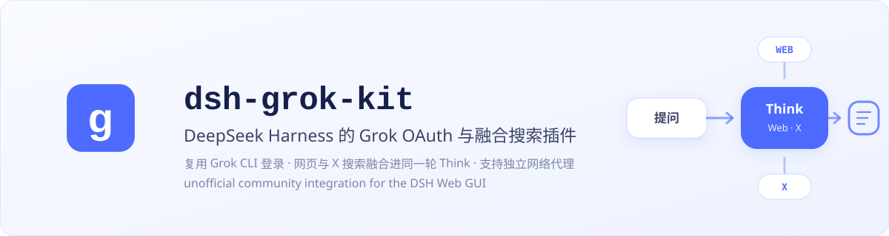
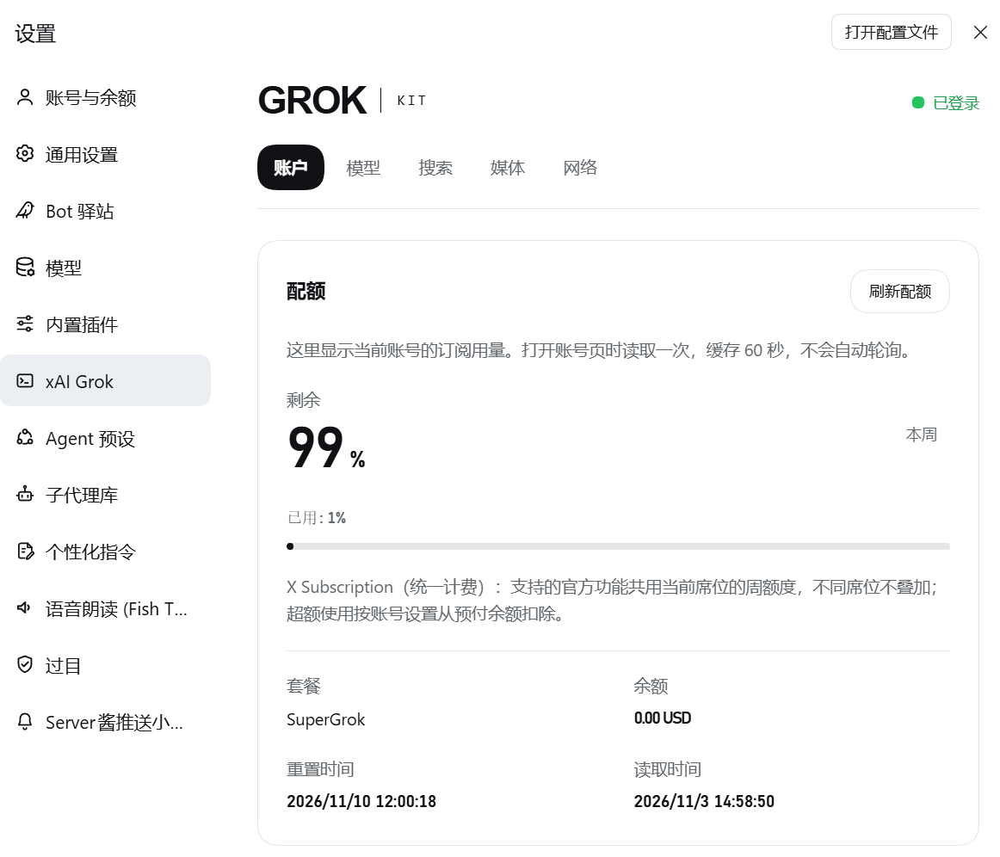
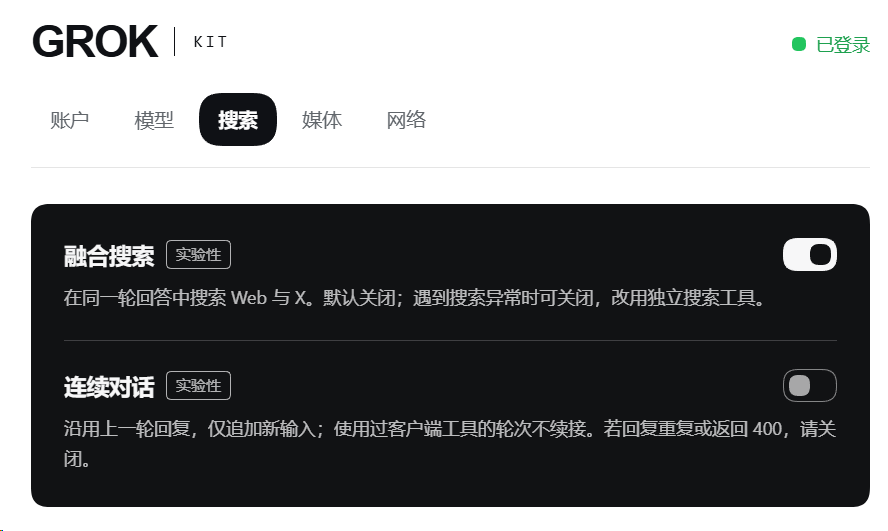
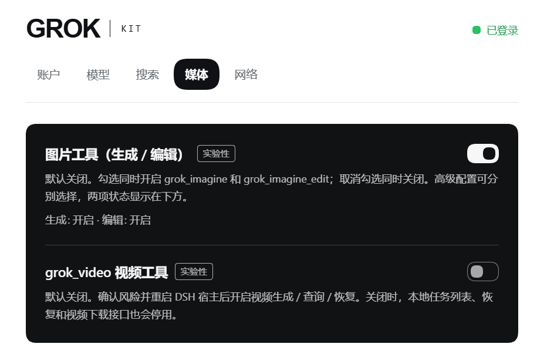
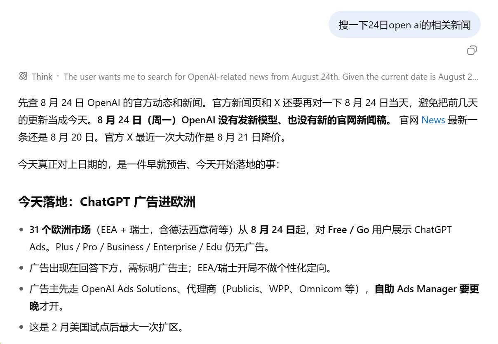

# dsh-grok-kit

**中文** · [English](README.en.md)

<p align="center">
  
</p>

<p align="center">
  <a href="https://github.com/MaRi23333/dsh-grok-kit/actions/workflows/ci.yml"></a>
  <a href="https://www.npmjs.com/package/dsh-grok-kit"></a>
  <a href="LICENSE"></a>
  
  
</p>

> 通过 OAuth 在 DeepSeek Harness 中使用 Grok：主循环融合网页与 X 搜索、多轮推理衔接、图片生成与编辑、视频生成（实验性），以及仅作用于 xAI 的独立代理。

## 不止于 OAuth 登录

`dsh-grok-kit` 为 [DeepSeek Harness](https://github.com/deepseek-ai/deepseek-harness) 增加独立的 `xai-oauth` 路由。它不要求 `XAI_API_KEY`，也不修改 dsh 源码；重点不只是“能登录”，而是把服务端搜索和连续 reasoning 所需的请求字段接进主聊天路径。

- **搜索融入主循环：** 网页与 X 检索发生在 Grok 的同一轮 Think 中，推理可以直接使用刚搜到的材料
- **多轮推理衔接：** 默认使用 high effort，并保留 `reasoning.encrypted_content`，让后续回合能够带回加密推理上下文
- **登录状态与 Grok CLI 同步：** 直接共用并回写 `~/.grok/auth.json`，不是只复制一次后各自轮换 refresh token
- **图片生成与编辑（实验性）：** `grok_imagine` 文生图、`grok_imagine_edit` 图生图（复用主 OAuth session），默认关闭，在设置页确认风险后开启；非聊天模型不会混进对话模型列表
- **会话图片卡片：** 生成与编辑的结果保存在 DSH 附件库，在会话卡片里直接显示提示词、输入图与结果，支持下载与再次生成/编辑
- **视频生成（实验性）：** 单图生成视频，任务持久化、断线恢复与按账号隔离的下载；默认关闭，确认风险并重启 DSH 后开启

此外还包括 xAI 专用代理、聊天 401 强制刷新重试、凭据原子写入、能力状态页与诊断脱敏等支撑能力。

### X Subscription 与原订阅

账号页的 **登录 Grok / X 订阅**共用官方 Grok OAuth，兼容 X Subscription 与原 SuperGrok / X Premium 订阅；已登录时可重新授权以切换账号，不必先删除共享凭据。账号页也提供[官方订阅管理入口](<https://grok.com/dashboard>)。

额度使用官方 billing/settings 返回的百分比、周期、套餐及预付余额。REST 缺少使用百分比时会补查一次 gRPC；只有响应完整、状态成功且周期有效时，才按 proto3 隐式零值显示已用 0%／剩余 100%，不能核实时仍保留订阅详情、已用/剩余未知，不冒充无限额度。补查使用独立短超时，失败或补查超时不会抹去已读取的部分数据；整次读取超时、取消和账号校验仍然生效。结果按账号最多缓存 60 秒，已核实用量的缓存不跨有效周期，返回前也会重新校验周期；缺百分比的未缓存读取至多多发一次 gRPC 请求，REST 429 不触发补查。周期有效性依赖本机时钟，时钟偏差可能影响周期判断和隐式零值显示。统一计费标记来自接口，不根据套餐名猜测；仅展示当前登录身份，不汇总不同工作区或席位。本插件不提供 Cursor 登录或其他模型、外部 Agent 的接入。

**0.2.10** 更新五页设置界面，新增供接入插件按会话控制融合搜索的接口，并更新 Zod 锁文件修复上游安全问题。已有账号和媒体风险确认规则保持不变；更新后重启 DSH。

## 主循环融合搜索

同一个模型 id，不代表不同接入方式一定有相同的使用体验。[xAI 官方说明 Grok Build 与公开 API 都提供 `grok-4.6`](https://docs.x.ai/build/overview)；真正影响搜索体验的，是服务端工具是否和主对话处在同一轮请求里。

**分离式搜索**会额外发起一轮模型请求完成检索或摘要，再把结果交回主对话。它仍然适合需要独立过滤条件的任务，但会多出一轮模型处理，而且搜索摘要不是在当前回复的 Think 中生成。

**主循环融合搜索**则按 [xAI Responses API 的服务端搜索方式](https://docs.x.ai/developers/tools/web-search)，把 `{type:web_search}` 与 `{type:x_search}` 直接放进主 Grok 请求。检索发生在 Think 里，模型能在同一轮推理中使用刚获得的网页和 X 材料；这条路径默认关闭（v0.1.8 起），可在设置页或配置中打开。

为让两类搜索共存，宿主原生 `web_search` 仍保留在 DSH 工具列表中，但会从启用融合搜索的 xAI payload 里移除，避免服务端工具重名；其他模型路由仍可照常使用宿主搜索。

从 0.2.10 起，接入插件可为各会话单独设置搜索开关，明确开启或关闭均可覆盖全局 `backendSearch`；未绑定的 DSH 会话仍使用全局配置。接入插件需支持此接口。

> 开启主循环搜索时，插件会剥掉 xAI 的 `x_keyword_search` 等收尾桩，避免 DSH 再开一轮并把同一篇正文再写一遍。这些名称若仍出现，属于故障诊断路径，不是正常用户体验。

需要按域名、账号或日期过滤时，改走独立的 `grok_web_search` / `x_search`（`backendSearch` 关闭时的默认路径）；开启 `backendSearch` 后这条独立路径退居可选。

`statefulResponses` 默认关闭。开启后，插件通过 `store: true` 和 `previous_response_id` 续接对话，只追加新的用户消息；若上一轮调用了 bash 等客户端工具，则不续接，以免重复生成已有的搜索正文。续接对话不保证缓存上一轮的全部搜索材料。

## 界面与效果

### 图片生成与会话卡片

<p align="center">
  
</p>
<p align="center"><em>一次实际文生图结果：图片直接显示在会话卡片中，可查看大图、下载、复制图片、复制提示词或重新生成。</em></p>

视频结果沿用同类卡片布局。图片生成、编辑和视频均为实验性能力，默认关闭，需在设置页确认风险后启用；实际可用性取决于账号资格与服务端限制。

<br><br>

### 设置页：账户、搜索与媒体

以下展示 0.2.10 的新版设置页，分为账户、模型、搜索、媒体和网络五页。

#### 账户与配额

<p align="center">
  
</p>
<p align="center"><em>账户页集中展示订阅用量与余额，可手动刷新配额。图中数据是截图时该账号的状态，不代表所有账号的配额或套餐。</em></p>

#### 搜索与连续对话

<p align="center">
  
</p>
<p align="center"><em>分别控制同一轮回答中的 Web / X 融合搜索与连续对话。两项均为实验性功能，默认关闭；图中融合搜索由用户手动开启。</em></p>

#### 图片与视频工具

<p align="center">
  
</p>
<p align="center"><em>图片开关同时控制生成与编辑，并显示两项实际状态；视频工具单独设置。媒体能力均为实验性功能，默认关闭，需确认风险后启用；视频还需重启 DSH，实际可用性取决于账号资格与服务端限制。</em></p>

<br><br>

### 网页搜索融入主循环

<p align="center">
  
</p>
<p align="center"><em>没有另起嵌套搜索工具卡片：网页检索直接发生在同一轮 Think 中，材料随即用于当前回复。截图里的新闻内容只用于展示交互，不作为事实来源。</em></p>

## 安装

桌面客户端和 Web 使用独立的插件安装与启用状态。请选择你实际使用的客户端；装到 Web profile 不会自动装到桌面端。

### 桌面客户端

1. 打开桌面客户端，在侧栏进入 **插件（Plugins）→ 添加插件（Add plugin）**。
2. 输入 `dsh-grok-kit@latest` 并安装；需要固定本版时输入 `dsh-grok-kit@0.2.10`。
3. 安装完成后点击 **立即启用（Enable now）**。若提示需要重启，通过应用菜单或托盘的 **Quit / 退出** 完整退出后重新打开；仅关闭窗口可能只是隐藏应用。
4. 在 **设置 → xAI Grok** 中确认插件入口出现，再按账号资格完成登录。

此方式不需要在 PATH 中配置 `dsh`。终端用户可按 [桌面配套 CLI 的安装步骤](INSTALL.zh.md#桌面端命令行) 操作；npm 全局安装或 `npx` 启动的 CLI 不能管理 `desktop` profile。

### Web / CLI

使用启动该 Web 实例的同一套 DSH CLI，从 npm 安装到 `web` profile：

```sh
dsh plugin --profile web add dsh-grok-kit@latest
dsh web
```

如果 Web 进程已经在运行，先停止它，安装后再运行 `dsh web` 并刷新页面。以下命令均用于 Web。

也可以固定安装 0.2.10：

```sh
dsh plugin --profile web add dsh-grok-kit@0.2.10
dsh web
```

如果 PATH 中没有 `dsh`，可以使用同一个 CLI 包（固定宿主版本）：

```sh
npx @deepseek-ai/dsh@0.2.0-rc.2 plugin --profile web add dsh-grok-kit@latest
npx @deepseek-ai/dsh@0.2.0-rc.2 web
```

如果这个 profile 以前安装的是 GitHub 来源，可先尝试 `dsh plugin --profile web add dsh-grok-kit@latest`；若来源没有切换，先移除旧包再重新添加。

**0.2.10** 包含设置界面、会话搜索接入及依赖安全更新，不改变账号的订阅权限。配额请求兼容模式默认关闭，仅影响额度查询；图片、编辑和视频仍默认关闭，首次开启需确认风险、保存并重启。宿主支持仍为 DeepSeek Harness `0.2.0-rc.2` 与 `@earendil-works/pi-ai@0.87.1`（Node 22/24），不支持旧 0.1 宿主线。完整变更见 [CHANGELOG.md](CHANGELOG.md)。

需要可复现的 Git 安装时，以下命令固定到审核提交；不带 SHA 的 `github:MaRi23333/dsh-grok-kit` 跟随 `main`，不是可复现锚点：

```sh
dsh plugin --profile web add github:MaRi23333/dsh-grok-kit#0578aad2ac07a60e664ae9b4f185dca477aeb2fd
```

完整 SHA 会固定安装结果；npm 安装则默认跟随 `latest` 稳定版本。

打开 **设置 → xAI Grok**，完成登录后选择 `xai-oauth / grok-4.6` 或账号当前可见的其他主线 Grok 模型。已经保存在 dsh 设置中的模型仍有更高优先级。

完整的安装、迁移、卸载和故障处理步骤见 [INSTALL.zh.md](INSTALL.zh.md)。

## 模型与工具

- 模型选择器只展示主线 Grok 聊天模型；Imagine、video、embedding、build/code 变体会被隐藏
- 默认 grok-4.6 描述符使用 high reasoning，并请求 `reasoning.encrypted_content`，以便后续回合带回加密推理上下文
- `grok_imagine`（文生图）与 `grok_imagine_edit`（图生图，复用主 OAuth session）默认关闭，需在设置页确认风险后开启。图片保存到 DSH 附件库并在会话图片卡片中直接渲染。可从卡片下载，或使用宿主文件工具导出；两工具的 `save_path` 参数均不再支持直接写盘
- dsh 原生 `web_search` 仍保留在宿主工具列表中，但会从启用 backend search 的 xAI payload 中移除，避免工具重名

模型列表来自登录账号的 `GET /v1/models` 结果，并在本地缓存。服务端能力或模型要求发生变化时，仍可能需要更新插件；不会把“模型 id 可见”等同于“所有能力一定可用”。

### 图片输入与再次编辑

- 本地图片路径：通过宿主文件系统（fs）有界读取，按实际宿主环境文件权限读取文件，受单图体积上限约束。运行卡片显示文件路径和“打开输入图片”入口；前端无法直接读取任意本地路径。
- 用户上传图片：DSH 将上传内容保存为会话附件。把宿主提供的完整 `attachment={...}` 引用传给 `grok_imagine_edit.image`；卡片通过会话 `readAttachment` 加载缩略图。
- 生成图片再编辑：工具结果包含 ImageBlock 和完整 `attachment={...}` 文本。将完整引用作为下一次 `image` 参数，附件服务会读取并验证保存后的图片并保留其归一化 metadata。
- 裸 `attachmentId=sha256:...` 仅在宿主附件库提供 `imageHostPath` 时支持；远程附件后端应使用完整引用。附件 ID 不是本地文件路径或 URL。
- data URI 输入经过解码大小、base64、图片签名和 MIME 一致性校验；远程 URL 由上游获取，卡片显示链接，避免浏览器自动请求任意远程地址。
- 会话卡片交互：运行卡片显示提示词和全部输入来源；图片完成后显示结果、下载入口与再次生成/编辑入口。再次编辑会保留全部输入图和原调用的渲染参数。

### 视频任务（实验性）

提供单图生视频、持久任务恢复与账号隔离下载，对应 `grok_video_generate` / `grok_video_status` / `grok_video_resume`，默认关闭。设置页的「媒体与任务」页会显示本地能力状态和任务列表。开启需要确认风险并重启 DSH；生成会消耗订阅额度，“停止等待”只是不再等待，不会取消已提交的任务。用法、配置及限制见 [视频说明](VIDEO.zh.md)。

### 媒体工具的开启与风险

图片、图片编辑和视频默认都是关闭的。打开 **设置 → xAI Grok →「媒体与任务」**，拨动开关后卡片里会出现风险确认：确认并保存，重启 DSH 宿主后工具生效；取消或不动，就不会有任何改变。图片开关同时控制生成和编辑，两项状态分开显示。正常使用（生成、再编辑、查询、下载）不会再弹确认；关闭后重新开启时才会再问一次。开启只保存设置，不生成媒体，也不探测额度。

先把几件事说清楚：这是第三方非官方接入，能否使用取决于 xAI 的账户资格和服务规则，随时可能被限制或暂停；生成会消耗订阅额度或产生费用；提示词和输入图片都会上传给 xAI，请不要发送敏感内容或无权使用的素材；“停止”只是停止等待，不会取消已提交的任务。

未确认的旧媒体开启值不生效，首次使用需明确确认；已确认的选择会持久保存，升级或重启不会重置。想分别控制 `imagineTool` / `editTool` / `videoTool`，可以在配置里显式设置并加上 `mediaRiskAcknowledged: true`——这只是本机的知情开关，不是凭据，也不代表官方许可。重置媒体页会撤销确认；关闭并保存后工具立即停止响应调用（已提交的任务不受影响），视频关闭时本地任务列表、恢复和下载接口一并停用，已有任务和附件保留。

## 配置

| 配置项 | 默认值 | 说明 |
| --- | --- | --- |
| `backendSearch` | `false`（默认关闭；设置页可打开） | 在主聊天请求中启用 xAI 服务端网页/X 搜索 |
| `nestedSearchTools` | 省略时取 `!backendSearch` | 注册独立的 `grok_web_search` / `x_search` |
| `statefulResponses` | 省略时 `false` | 显式打开才用 `store` + `previous_response_id`；`toolUse` 回合不续链 |
| `searchModel` | `grok-build-0.1` | 嵌套搜索模式使用的模型 |
| `searchMaxResults` | `8` | 嵌套搜索返回来源的上限 |
| `webSearchTimeoutMs` | `60000` | 嵌套网页搜索的协作式超时预算 |
| `xSearchTimeoutMs` | `120000` | 嵌套 X 搜索的协作式超时预算 |
| `imagineTool` | `false` | 确认媒体风险后注册 `grok_imagine`（文生图） |
| `editTool` | `false` | 确认媒体风险后注册 `grok_imagine_edit`（高级配置可独立于 `imagineTool`，设置页图片开关控制两项） |
| `videoTool` | `false` | 确认媒体风险后注册视频生成、查询和恢复工具 |
| `videoModel` | `grok-imagine-video-1.5` | 视频生成模型（实验性，只读展示；当前仅接受这一个值） |
| `videoMaxBytes` | `104857600` | 视频下载大小上限（字节，默认 100 MiB；只读展示） |
| `mediaRiskAcknowledged` | `false` | 显式确认上述媒体风险；需与所选媒体开关均为 `true` 才启用 |
| `editModel` | `''` | 固定图生图模型；为空时跟随线上目录自动选择（优先 `grok-imagine-image-2.0`，fallback `grok-imagine-image`） |
| `editMaxSourceImages` | `5` | `grok_imagine_edit` 单次请求源图片上限，插件最多接受 5 张 |
| `editMaxImageBytes` | `20971520` | `grok_imagine_edit` 单张源图片体积上限（默认 20 MiB） |
| `proxyUrl` | `''` | xAI 专用 HTTP/HTTPS 代理；设置页保存值优先 |

本 bundle 的组合默认值来自 `cordis.patch.yml`。手工拆分或重组配置时，可用 `dsh --profile web --dump-config` 核对最终值。

设置页 → xAI Grok →「搜索与对话」或「媒体与任务」可分别覆盖相关搜索/功能键；保存和重置只影响当前页，切页保留草稿（保存后重启生效；未修改的键继续跟随组合默认值，不会固化）。「网络」页的 `proxyUrl` 保存即生效。路线与后续候选见 [路线文档](ROADMAP.zh.md)。

「网络」页另有默认关闭的 **配额请求兼容模式**。若登录、聊天正常但额度读取因全局 `fetch` 包装链冲突而超时，可开启此项并保存：仅额度请求改用插件专用通道，每次请求动态使用当前 xAI 代理，不影响聊天和登录；代理留空时专用通道明确直连，不跟随宿主的全局 `fetch` 或全局 dispatcher。开关与代理地址一起保存后立即生效，无需重启，并清除旧配额缓存。页面显示实际生效的地址（含配置/环境变量回退），保存会将该地址作为插件存储覆盖，优先于配置/环境变量。凭据目的地、禁止重定向、超时/取消和账号隔离保护不变；此模式不保证解决所有插件组合的网络故障。

**出口控制提醒：依赖宿主级强制出口、DLP 或强制网络包装的环境不要开启兼容模式。** 若只需要固定出口代理，请同时填写插件代理 URL；这不能恢复被绕过的宿主控制。兼容通道只接受三条固定的官方额度端点，不是通用网络出口。网络设置初次加载失败时，可点击“重试加载网络设置”；重试保留未保存草稿，加载成功前仍禁止保存。

## 登录文件、代理与安全边界

- 优先使用 `~/.grok/auth.json`，与 Grok CLI 原地共用同一份 xAI 凭据；登录和刷新都会写回该文件，而不是只做一次性导入；在设置页退出也会让 Grok CLI 退出
- OAuth 刷新令牌会轮换；插件用原子写入、进程内合并和 compare-and-write 避免并发刷新互相覆盖
- 浏览器状态接口、错误信息和诊断不会返回 token 值
- OAuth access token 只发送到 HTTPS 的 `api.x.ai`、`cli-chat-proxy.grok.com`，以及 `https://grok.com/grok_api_v2.GrokBuildBilling/GetGrokCreditsConfig` 这一条额度 URL。带 Authorization 的请求拒绝重定向，包括聊天 SDK 发出的实际请求；此检查不扩展为允许任意 `x.ai` 子域名。OAuth 设备码授权与令牌刷新的表单请求，以及不带 token 的视频下载仍走各自原有流程。
- 插件接口只接受本机回环连接与回环 Host，并校验浏览器来源。桌面端的 `dsh-app://app` 页面受信任；没有 Origin、但携带 Fetch Metadata 的本机请求也可写入设置。该标记不是桌面身份或权限证明：本插件不隔离本机进程或桌面渲染器。不要将接口暴露到局域网或公网，也不要在不可信的多用户环境共享凭据目录。
- 代理只接受不含用户名/密码的 `http://` 或 `https://` URL；带 userinfo 的旧值会被清理，不会进入状态响应或日志
- 代理通过同一 DSH 进程的全局 `fetch` hook 按目标分流：匹配 `x.ai`、其子域名、`cli-chat-proxy.grok.com`，以及 `grok.com` 上精确的 `GetGrokCreditsConfig` 额度回退路径。因此也会影响其他组件通过该 hook 发往这些地址的请求。`grok.com` 的其他路径和其他请求交给原有 `fetch` 处理，不强制直连；插件卸载时恢复 hook，不永久修改系统或进程环境变量。同一 OAuth bearer 在额度回退时也会发往 `grok.com`。
- Windows 上的 Node mode bit 不等于 NTFS ACL；如果用户目录或 `$DSH_HOME` 位于共享位置，请自行收紧目录权限
- 凭据写入的锁委托官方 `@deepseek-ai/dsh-atomic-write`（锁文件 `$DSH_HOME/.xai-oauth-auth.json.lock`）。同一台机器、同一 PID 命名空间内，后来者可以用独占 claim 文件加二次存活性检查，接管并回收确认已退出的进程留下的锁；对方还活着、权限不明、内容损坏或是空锁时，继续等待直至超时（宁可失败也不抢锁）。凭据和锁目录必须放在本机文件系统上，且处于同一 PID 命名空间——跨机器或跨容器共用同一目录会让 PID 对不上号，互斥可能失效并发生并发双写。运行期间手动替换凭据或锁文件会破坏这些保证；确需清理时，先停掉所有相关进程

## 兼容性与限制

- 当前支持矩阵冻结为：DeepSeek Harness `0.2.0-rc.2` + `@earendil-works/pi-ai@0.87.1`（Node 22/24）。不再宣称兼容旧 0.1 宿主线。
- 某些订阅档位可能允许浏览器登录，却对聊天或服务端搜索返回 HTTP 403；这是账户资格/服务策略问题，不等同于 token 过期
- HTTP 401 会在串行刷新后重试一次；403 不会按 token 过期处理
- 不支持与另一个注册相同 xAI OAuth 路由的 bundle 同时安装；请先按 [INSTALL.zh.md](INSTALL.zh.md) 的迁移步骤移除冲突 bundle
- backend search 默认关闭，可在设置页或配置中开启；可用性仍由账号、模型和 xAI 当前服务决定
- 删除插件不会自动删除 `~/.grok/auth.json`；需要清理本地登录时，请先在设置页退出

## 故障排查

**启动或聊天报 `timed out waiting for the writer lock`**：某次异常退出的写入进程遗留了未被自动回收的锁（如活进程占用、非规范锁、权限异常，或崩溃遗留的 `.takeover-*` claim 文件）。插件委托官方协议安全接管已退出进程的锁，但为避免误删活跃写入者的锁，活锁与无法验证的锁不会盲目清理。请按以下步骤手动排查：

1. 关闭所有 DeepSeek Harness 与 Grok CLI 进程，并通过系统进程列表确认已无相关运行中的后台进程；
2. 确认进程完全停止后，删除 `$DSH_HOME`（默认 `~/.dsh`）下的 `.xai-oauth-auth.json.lock` 以及可能残留的 `.xai-oauth-auth.json.lock.takeover-*` claim 文件；
3. `~/.grok/auth.json.lock` 属于 Grok CLI，仅在确认 Grok CLI 完全退出后删除；
4. 重新启动。

启动时的目录刷新失败（含上述锁超时）不会阻断聊天：插件先用缓存的模型列表，并在后台按 5s / 30s / 120s 退避重试。

## 实测反馈流程

欢迎通过 issue 反馈问题、提出建议，也欢迎通过 PR 参与改进。拥有有效 SuperGrok / X Premium 订阅的用户可以按 [live-testing 模板](https://github.com/MaRi23333/dsh-grok-kit/issues/new?template=live-testing.md) 开 issue，逐项记录聊天、连续对话、工具调用、搜索与 Imagine 的通过 / 失败 / 未测状态，并附上插件版本、`dsh --version`、Node 版本、操作系统、订阅档位（按官方原文）、测试日期和最小复现步骤。提交前先脱敏：不要粘贴 token、`auth.json` 内容、账号邮箱、session id、私有路径或私密对话内容。

提交前请先搜索[现有 issue](https://github.com/MaRi23333/dsh-grok-kit/issues)，有相同问题时把结果补充到原 issue，不要重复开帖。不要仅为测试续订订阅，也不必覆盖每一个可选功能；单次会话中一项或几项的真实结果同样有价值。

## 开发

```sh
npm ci
npm run check
dsh plugin --profile web add ./dsh-grok-kit
```

日常开发运行 `npm ci`（或 `npm install`）并使用 `npm run check` 即可完成类型检查、测试与构建。当需要在本地开发环境中链接真实宿主依赖进行调试时，可按需可选运行 `node scripts/link-host-deps.mjs`（非强制，避免误改用户本地 profile）。

CI 在 Node.js 22 与 24 上执行 frozen install、typecheck、测试、构建，并确认提交的 `lib/` 与源码构建结果一致。

## 许可证与致谢

[Apache-2.0](LICENSE)。部分代码源自 Apache-2.0 许可的 `dsh-xai`，详见 [NOTICE](NOTICE)。特别感谢 [KouzakiUmi](https://github.com/KouzakiUmi) 在图生图（`grok_imagine_edit`）、会话图片交互卡片以及宿主依赖稳定性与兼容性修复方面的贡献。

> [!IMPORTANT]
> **非官方项目、商标与账户使用声明**
>
> `dsh-grok-kit` 是由社区独立开发的 DeepSeek Harness 第三方插件，不是 xAI、X、DeepSeek、DeepSeek Harness 或这些项目维护者的官方产品，也不代表它们。本项目不主张已获得上述主体对本插件或其名称的个别许可、背书、赞助或认可。Grok、xAI、X、DeepSeek、DeepSeek Harness 及相关名称与标识归各自权利人所有；本项目仅为准确说明兼容对象而提及这些名称。
>
> OAuth 可用性可能受订阅档位、地区、xAI 条款、账户资格、速率限制和后续服务变更影响。用户应自行确认其账户与用途获准；本项目不保证持续可用性或兼容性，也不提供 xAI/Grok 账号、订阅或官方支持。
